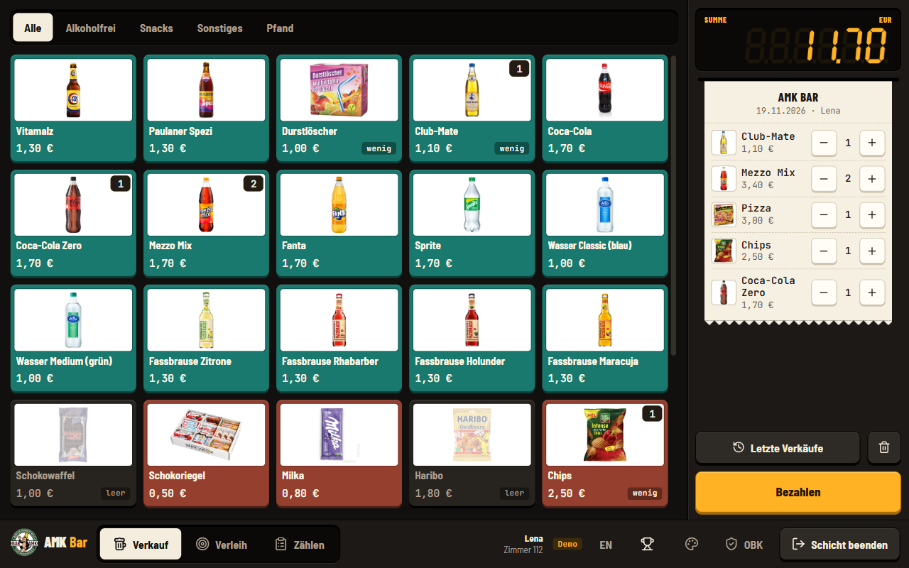
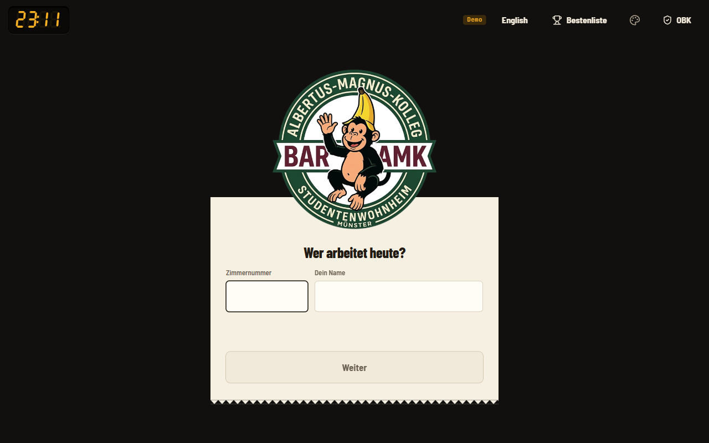
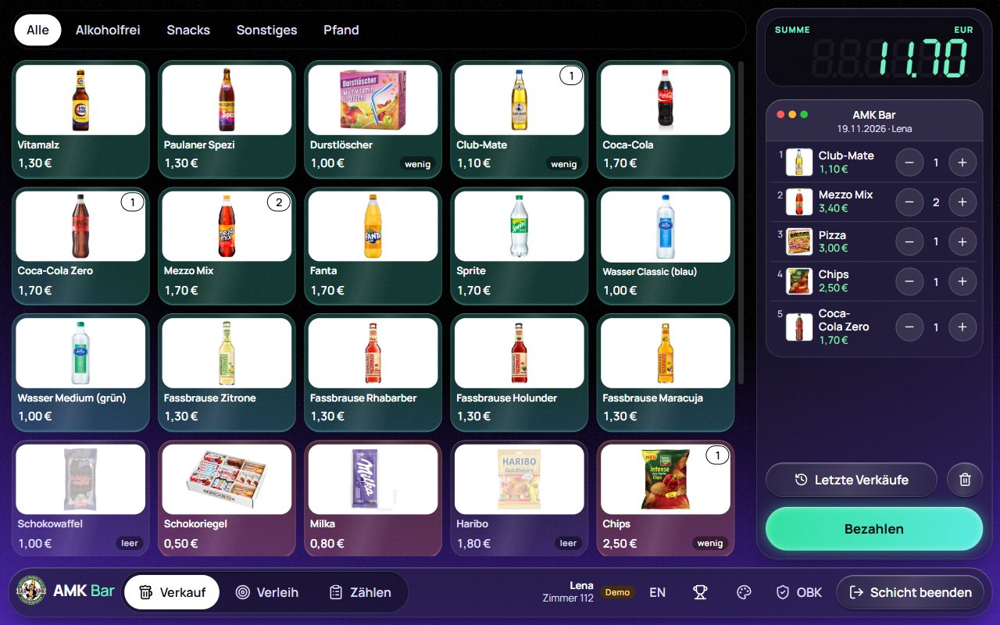
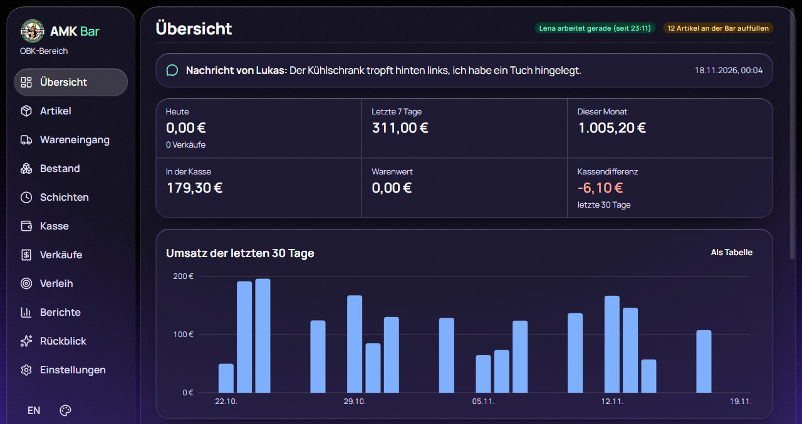

# AMK Kasse

A till for a small bar, made for the student bar at the Albertus Magnus dorm in Münster. It sells drinks and snacks by touch or barcode scanner, lends cues and darts for a deposit, counts stock, and gives the bar team a PIN-protected area for products, stock, money and reports.

It runs offline on one Windows PC: one program, one data folder, nothing to install.

## Download

- **[AMK-Kasse.exe](https://github.com/aymksen/amk-kasse/releases/latest/download/AMK-Kasse.exe)** for Windows 10 and 11
- [AMK-Kasse-32bit.exe](https://github.com/aymksen/amk-kasse/releases/latest/download/AMK-Kasse-32bit.exe) for older 32-bit PCs
- [AMK-Kasse-Windows.zip](https://github.com/aymksen/amk-kasse/releases/latest/download/AMK-Kasse-Windows.zip) with both, a demo starter and a PIN reset

## How to use

1. Put the program in its own folder, for example `C:\AMK-Kasse`. It keeps its data next to itself.
2. Double-click it. If Windows warns about an unknown app, click **More info** and then **Run anyway**.
3. The till opens full screen. Tap **OBK**, choose a PIN, and set up your products and prices.
4. Each shift starts with a room number and a name, a quick stock check, and then selling.

To try it with invented sales first, run `AMK-Kasse.exe -demo` or `Demo starten.cmd` from the zip. Your real data is not touched.

The [full guide](docs/guide.md) covers scanners, backups, styles, the optional [online dashboard](dashboard/README.md) and building from source.

## Screenshots

| Start of a shift | Glass style |
|---|---|
|  |  |

## Build from source

Needs Node.js and Go. Run `build.cmd`; the programs land in `dist`.

